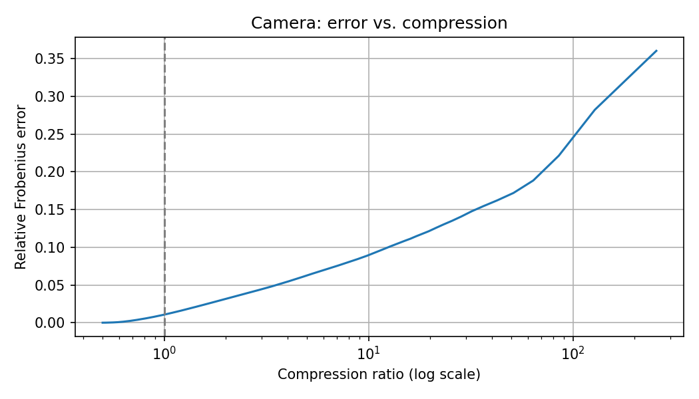
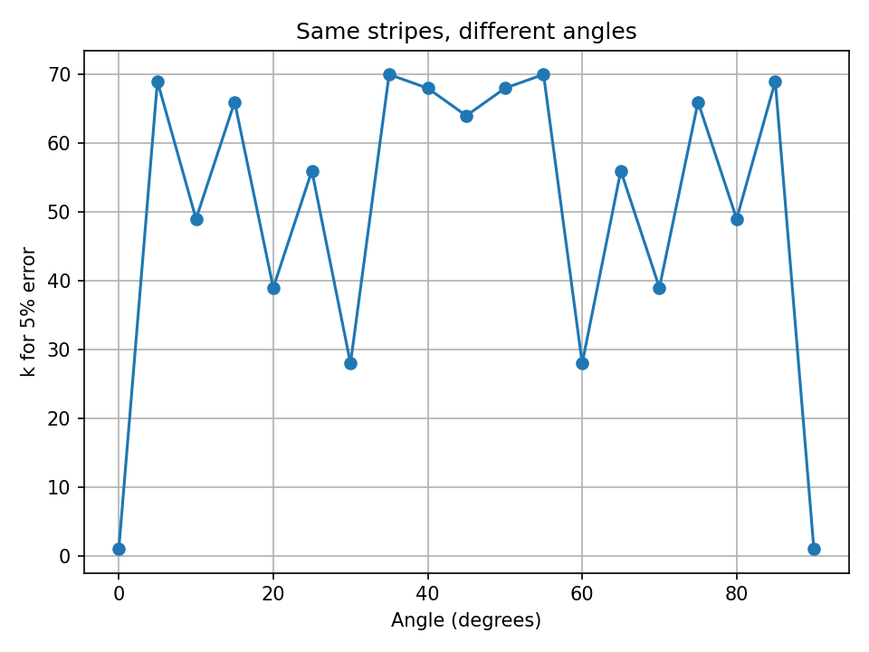

# How Much of a Photo Can You Throw Away? — SVD Image Compression

**Project status:** Source code, all five milestone notebooks, generated figures, and a personal photograph are included. The notebooks were executed locally; before submission, review the explanations and upload the repository to GitHub/Colab.

## Question
How does the SVD rank affect quality and mathematical storage savings? Why are some patterns compressible at far lower rank than others?

## Idea
A grayscale image is a matrix $A$ of intensities, and SVD represents it as $A=U\Sigma V^T$. A rank-$k$ approximation retains the first $k$ singular values and vectors. It stores $k(m+n+1)$ floating-point numbers rather than $mn$ original values.

## Results to verify
Run notebooks in order. The hero figure appears above; notebooks 03 and 04 save `figures/error_vs_ratio.png` and `figures/angles.png`.

### Limitations
The number-of-values ratio ignores storage types, file headers, and actual compression formats (such as JPEG); Frobenius error may not reflect text legibility.

## Run instructions
Download/extract the project, open a terminal in its root directory, install `pip install -r requirements.txt`, then open `notebooks/01_image_as_matrix.ipynb` using Jupyter or Colab. Run from top to bottom. For Colab, upload this folder to a GitHub repository first or configure your working directory correctly.

## Data
Camera, astronaut, and text samples come from scikit-image (`skimage.data`). A personal photograph is included at `data/my_photo.png` and credited in `data/README.md`.

## AI assistance disclosure
An AI assistant generated an initial editable set of Python notebooks and repository files from the course milestone handouts. The student should independently run, verify, revise, and explain the calculations and results.

## References
Eckart, C., and Young, G. (1936), *The approximation of one matrix by another of lower rank*, Psychometrika 1, 211–218.

MATH 344L — University of South Carolina — Fall 2026.
