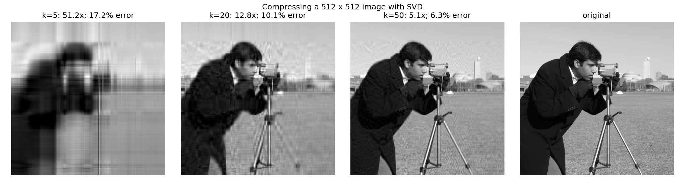

# How Much of a Photo Can You Throw Away? — SVD Image Compression

**Project status:** Five notebooks, shared Python functions, generated figures, and a personal photograph are included. Milestones 1–3 have been tested in Colab; the latest updates to Milestones 3–4 should be rerun and saved with outputs before submission.

## Question
How does the SVD rank affect quality and mathematical storage savings? Why are some patterns compressible at far lower rank than others?

## Idea
A grayscale image is a matrix $A$ of intensities, and SVD represents it as $A=U\Sigma V^T$. A rank-$k$ approximation retains the first $k$ singular values and vectors. It stores $k(m+n+1)$ floating-point numbers rather than $mn$ original values.

## Results

- **Storage vs. quality:** For the 512×512 camera image, rank 21 achieves approximately 9.88% relative Frobenius error with 12.18× theoretical count-based compression; for my 800×600 photograph, rank 17 reaches about 9.92% error with 20.15× theoretical compression. I would share rank 34 of my photograph instead, because its approximately 7.39% error and 10.08× theoretical compression offer a sharper result.
- **Which images SVD likes:** Tilting a 256×256 striped image by just 5° raises the number of SVD terms needed for 5% relative error from 1 to 69, multiplying idealized factor storage by 69 even though the image still consists of stripes. Horizontal stripes and the checkerboard have few independent row patterns; random noise and tilted patterns generally require more terms.

Theoretical ratios compare stored **numbers** rather than physical compressed file sizes. The figure files can be regenerated using `python scripts/build_figures.py`.

### Limitations
The number-of-values ratio ignores numeric data types, file headers, and actual compression formats (such as JPEG). For float64 SVD factors versus uint8 pixels, actual byte savings may be much smaller. Frobenius error also does not directly measure text legibility or important facial details.

## Run instructions
Open any notebook directly from GitHub in Colab, run its setup cell to clone or update the repository in `/content/svd-image-compression`, then use **Runtime → Restart session and run all**. To run locally, install `pip install -r requirements.txt` in the repository root and start Jupyter. To regenerate the committed figures, run `python scripts/build_figures.py` from the project root.

## Data
Camera, astronaut, and text samples come from scikit-image (`skimage.data`). A personal photograph is included at `data/my_photo.png` and credited in `data/README.md`.

## AI assistance disclosure
An AI assistant generated an initial editable set of Python notebooks and repository files from the course milestone handouts. The student is responsible for running, verifying, revising, and explaining the calculations and results.

## References
Eckart, C., and Young, G. (1936), *The approximation of one matrix by another of lower rank*, Psychometrika 1, 211–218.

MATH 344L — University of South Carolina — Fall 2026.
